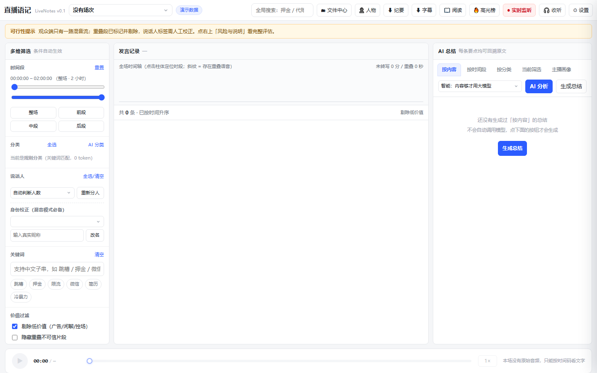
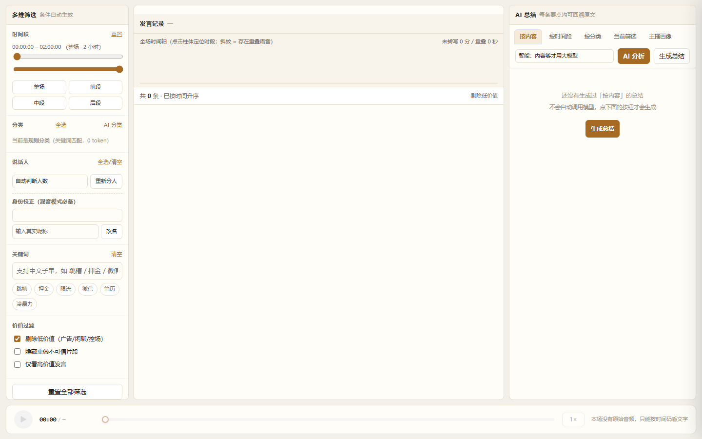
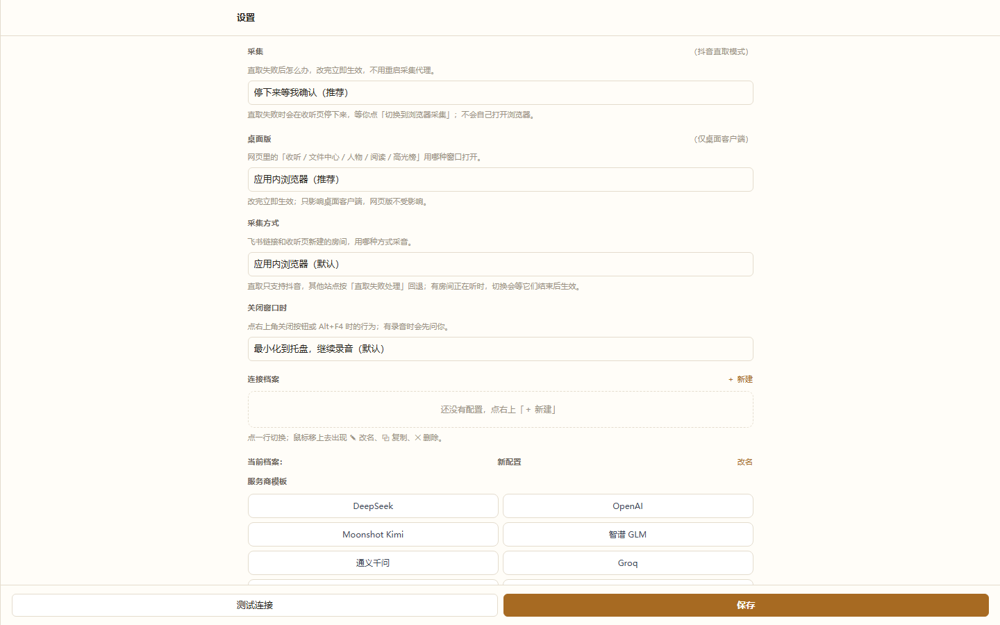

# 29 · 页面与宿主契约（基座 + 桌面皮肤）

> 结论先行：**一套页面，两个宿主**。`app/web` 只出标准网页版和一个很薄的
> 宿主适配器；桌面专属的观感、文案、壳内交互放在 `desktop/web`（overlay），
> 通过清单在运行时叠上去。同一路径 overlay 优先，页面 HTML 永远来自基座。

这份文档是「第 7 条契约」——[docs/19 §5.2](19-electron-vs-tauri.md) 的六条
契约管 Shell / Engine / 工具，这一条管**页面 ↔ 宿主**。

---

## 1. 为什么不是「共享代码」而是「契约」

共享本身没问题，问题出在三处，都是结构性的：

| 旧做法 | 后果 |
|---|---|
| 桌面效果写进 `app/web/css`、`embed.js` | 改桌面必然回归网页版，且没有测试会红 |
| 共享页面里 `if (window.__LN_DESKTOP__)` | 网页永久背上桌面分支，AI 会继续复制这个模式 |
| 页面文案按网页版写死 | 桌面点进去是死路（如「回到工作台点实时监听」） |

分层之后，这三件事分别被目录边界、能力查询、文案清单挡住，并且有
`tools/check_web_layers.py` 在 CI 里判红。

---

## 2. 三层与目录

```
app/web/                         基座（任何浏览器打开都一样）
  js/embed.js                    宿主适配器：?embed=1 时才工作
  css/embed.css                  嵌入模式让位（协议层，不是桌面皮肤）
  css/index.css                  冷色 token：--spk-* / --cat-*
  *.html                         页面：唯一允许出现页面结构的地方
app/webroot.py                   静态分层：overlay 优先、基座兜底、清单
desktop/web/                     桌面皮肤（overlay，只有资源，没有页面）
  host.json                      清单：css / js / capabilities / copy
  css/paper.css                  纸面主题（覆盖 token 与表面色）
  css/desktop.css                右键菜单 / 全库搜索 / 轻提示
  js/desktop.js                  上述交互 + data-ln-copy 文案覆盖
```

加载链路（桌面壳打开 `/?embed=1&theme=paper`）：

```
页面 <script src=/static/js/embed.js>   ← 同步、先于页面模块
  └─ 加 html.ln-embed*、落 data-theme、注入 /static/css/embed.css
  └─ fetch /api/host/manifest
       ├─ overlay=false（网页版）→ 什么都不加载，结束
       └─ overlay=true → 依次加载 css[]、js[]，再派发 ln:host-ready
```

`/api/host/manifest` 在网页版返回 `{"overlay": false, ...}` 而不是 404，
避免网页控制台每次刷新留一条红字。

---

## 3. 静态优先级

`/static/<path>` 的解析顺序（`app/webroot.py:resolve_static`）：

1. overlay 目录（`LIVENOTES_WEB_OVERLAY` 或打包后的 `app/web-overlay`）；
2. 基座 `app/web`；
3. 都没有 → 404。

两个根目录都做 `is_relative_to` 校验，`/static/../app/config.py` 一律 404。
**页面 HTML 不参与覆盖**——overlay 里放 `index.html` 无效，这是刻意的：
皮肤不是分叉。

---

## 4. 清单 `host.json`

```json
{
  "version": 1,
  "host": "desktop",
  "name": "LiveNotes 桌面版",
  "css": ["/static/css/paper.css", "/static/css/desktop.css"],
  "js": ["/static/js/desktop.js"],
  "profile": {
    "host": "desktop",
    "capabilities": ["native-windows", "tray", "host-menu", "host-search"],
    "copy": {
      "rooms.foot-hint": "桌面版没有浏览器标签页可抓，在「收听」里粘贴直播间链接……"
    }
  }
}
```

- `css` / `js` 只收 `/static/` 开头且**真实存在**的路径，坏路径被丢掉并进
  `warnings`（不会让整页白屏）；
- `capabilities` 是页面做能力判断的唯一依据（替代 `__LN_DESKTOP__`）；
- `copy` 的 key 必须能在基座 HTML 里找到 `data-ln-copy="<key>"`，否则检查失败。

---

## 5. 锚点与 token

### 5.1 `data-ln-region`

皮肤只能从这些锚点起头写选择器：

| 页面 | 锚点 |
|---|---|
| `index.html` | `topbar` · `workbench` · `sidebar` · `stage` · `inspector` · `transport` · `notice` |
| `rooms.html` | `topbar` · `stage` |
| `library / people / reader / highlights / live / pushes / glossary` | `topbar` · `stage` |
| `metrics.html` | `topbar` · `stage` |

新增页面时，只要会被 `?embed=1` 打开，就必须带 `topbar` 和 `stage`
（检查脚本会红）。锚点 <-> 结构的映射只在基座改，皮肤不感知。

### 5.2 CSS 变量

| 变量 | 用途 | 基座默认 | 桌面皮肤 |
|---|---|---|---|
| `--spk-0..9` | 说话人色板 | 冷色 | 暖纸色 |
| `--cat-substantive` 等 5 个 | 分类色 | 冷色 | 暖纸色 |
| `--bg / --panel / --text / --border / --accent` | 页面通用表面 | 冷白 | 暖纸 |

JS 只引用 `var(--spk-N)` 字符串，由浏览器在绘制时解析；所以主题 CSS
异步到达也不会让颜色停在旧值——换肤不再需要 JS 分支。

### 5.3 文案

基座写网页版说法，节点上标 `data-ln-copy="<key>"`；桌面皮肤在
`profile.copy` 里给覆盖文本。**不允许**在基座里写「桌面端这里应该……」的
条件分支。

---

## 6. 事件与消息

页面内（`document`）：

| 事件 | 时机 | `detail` |
|---|---|---|
| `ln:host-ready` | 清单加载完（网页版也会发，profile 为空） | 宿主 profile |
| `ln:session-change` | 工作台切场次 | `{session}` |

跨窗口（`postMessage`，页面 → 父窗口）：

| 消息 | 说明 |
|---|---|
| `ln-hello` | 适配器就绪：`{contract, host, page}` |
| `ln-navigate` | 同源链接被点击，宿主决定怎么打开 |
| `ln-key` | `Ctrl+K` / `Ctrl+1..5` |
| `ln-session-changed` | 兼容旧壳（工作台切场次） |

`contract` 目前是 `1`；不兼容变更要加版本，不能悄悄改字段语义。

---

## 7. 规则（检查脚本强制执行）

`python tools/check_web_layers.py`：

1. 基座（除 `js/embed.js`、`css/embed.css`）不得出现 `__LN_DESKTOP__`、
   `ln-embed`、`embed=1`、`/static/css/paper.css`；
2. 每个可嵌入页面必须有 `topbar` / `stage` 锚点；
3. overlay 不得放 `.html`；CSS 选择器必须以 `html` / `[data-ln-region]` /
   `[data-theme]` / `.ln-` 开头，禁止 `@import`、`@media`（媒体查询属于基座）；
4. `host.json` 的 css/js 必须存在，`copy` key 必须被基座用到。

`tests/test_web_layers.py` 另外覆盖：静态优先级、网页版 404、manifest 两种模式、
坏路径被丢弃、overlay 不能替换页面、目录穿越、清单检查自身能抓违规。

---

## 8. 开发与打包

| 场景 | 怎么带上 overlay |
|---|---|
| 桌面开发态 | 壳拉起引擎时加 `--web-overlay desktop/web`（`engine.rs`） |
| 手工调试 | `python run.py --web-overlay desktop/web` |
| 打包 | `package-engine.py` 把 `desktop/web` 放进 `app/web-overlay`；引擎自动发现 |
| 纯网页版 | 什么都不传，`/api/host/manifest` 返回 `overlay: false` |

---

## 9. 验收

同一份 `index.html`，两个宿主：

| 网页版 `python run.py` | 桌面版 `--web-overlay desktop/web` |
|---|---|
|  |  |

设置页在桌面壳里整页铺满，且「桌面版」能力行只在 `native-windows` 宿主出现：



---

## 10. 已知边界

- `app/web/css/embed.css` 属于**协议层**（藏顶栏、设置页铺满），不是桌面皮肤；
  它由适配器加载，网页版不会请求。
- `index/list.js`、`index/subs.js` 里的右键菜单是能力探测
  （`if (!window.LN || !window.LN.menu) return`），网页版走浏览器原生菜单；
  这是允许的「宿主能力」，不是桌面分支。
- `desktop/dist/shell.js` 仍按 `?embed=1&theme=` 打开页面，契约未变；
  壳自己的 CSS/JS 不参与本契约。
